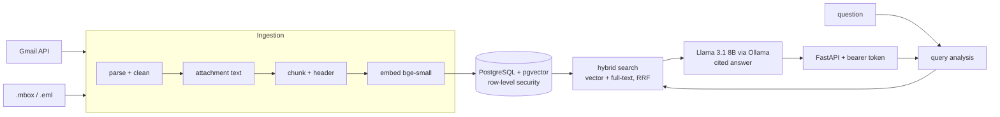

# Architecture

A local pipeline that turns a Gmail mailbox into a searchable knowledge base and answers questions about it with an
open-source LLM. Every component runs on the user's machine.

## Components and why

| Layer | Choice | Reason |
|---|---|---|
| LLM | Llama 3.1 8B Instruct, 4-bit (Q4_K_M), served by Ollama | Best answers in the comparison below, about 20 tokens/s on a laptop-class chip, 5 GB of memory. |
| Embeddings | `BAAI/bge-small-en-v1.5` (384-d, 33M parameters), via sentence-transformers | Fast on CPU/Apple GPU (about 570 chunks/s) with retrieval quality equal to larger models in hybrid search. |
| Vector DB | PostgreSQL 17 + pgvector 0.8 | One system for vectors, full-text search, metadata filters, transactions and row-level security. |
| Gmail | Gmail API, read-only OAuth scope, `format=raw` | Raw MIME carries attachments, so one parser serves Gmail and `.mbox` files. Incremental sync via the history id. |
| API | FastAPI, bearer tokens | The caller's identity comes from a verified token only. |

No orchestration framework: the application is about 1,700 lines of plain Python, which keeps each step measurable.

## Ingestion

1. **Parse** (`ingest/parser.py`): sender, recipients, cc, subject, UTC timestamp, thread id. Prefers `text/plain`, falls
   back to HTML-to-text, strips quoted replies and signatures, and tolerates missing headers, bad dates and unknown charsets.
2. **Attachments** (`ingest/attachments.py`): PDF, DOCX (including tables), XLSX, text, HTML. Each becomes its own
   document linked to the parent email, so a fact found only in a PDF is retrievable and cites the email. Unsupported or corrupt files are skipped.
3. **Chunk and embed**: about 220 words with 40 words of overlap. Every chunk is prefixed with `From / To / Date / Subject`, so
   both the embedding and the full-text index can match "what did Sarah say" on names and dates, not only on topic.
4. **Store**: idempotent. A content hash skips unchanged emails and replaces edited ones. Gmail sync keeps a history cursor,
   fetches only new mail, removes deleted mail, and falls back to a full pass if the cursor expires. A partial run (`--max`, `--query`) never advances the cursor.

## Retrieval and answering

- **Hybrid search**: top 30 chunks by cosine similarity and top 30 by PostgreSQL full-text rank, merged with reciprocal rank
  fusion (k=60). Chunks are grouped by document; results far below the best score are dropped.
- **Query analysis**: a sender named in the question ("Sarah", "marketing team") restricts results to that sender and
  mail addressed to them. "When did I last hear from X" is answered by date order, not similarity.
- **Prompt**: numbered context blocks (sender, date, subject, attachment name) in chronological order, with rules to use
  only the context, cite `[n]`, report the latest value when a later email updates an earlier one, and say so when the answer is not there.
- **Output**: the answer, plus each cited source with date, sender, subject and a link back to the Gmail message (attachments link to their email).

## Embedding model selection

Four 384/768-dimension models were compared on 2,027 chunks and 21 retrievable gold questions (dense search only):
bge-small, MiniLM-L6, e5-small-v2 and bge-base. Hit@5 ranged from 90% to 95% and MRR from 0.83 to 0.90. With a gold set this small a
one-question difference is 5 points, so these are not significant differences. In the full hybrid pipeline bge-small reaches 100% hit@5, and
the larger bge-base is 3x slower to embed for no demonstrated gain. bge-small was kept for speed and size; e5-small-v2 had the best MRR and is the first candidate if a larger evaluation shows a real gap.

## LLM selection and quantization

On 25 gold questions (answer correctness, citations, declining unanswerable questions):

| Model | Pass | Declined unanswerable | Cites sources | Tokens/s | Median generation |
|---|---|---|---|---|---|
| Llama 3.1 8B, Q4 | 100% | 100% | 100% | 20 | 3.6 s |
| Llama 3.1 8B, Q8 | 100% | 100% | 95% | 11 | 5.6 s |
| Phi-3 Mini 3.8B | 88% | 50% | 62% | 36 | 3.6 s |

Q8 gave no quality gain over Q4 on this task at 1.8x the latency, so Q4 is the default. Phi-3 is faster per token but answered two unanswerable
questions with invented facts, which is the failure that matters most for an email assistant. The model is one setting (`LLM_MODEL`).

## Vector database configuration

- `chunks.embedding vector(384)`, embeddings L2-normalized, cosine distance (`<=>`).
- HNSW index with pgvector defaults (`m=16`, `ef_construction=64`, `ef_search=40`); GIN index on the generated `tsvector`
  column for full-text search; btree indexes on `(user_id, sent_at)`, `(user_id, thread_id)` and `chunks(user_id)`.
- At the tested scale (2,000 documents) the search stage takes about 5 ms. For much larger mailboxes, pgvector 0.8 iterative index scans would be needed because filtered HNSW queries can return fewer than the requested rows.
- The embedding dimension is fixed in the schema; changing models needs a schema change and re-ingest.

## Multi-user isolation

Two independent layers, so a bug in one does not expose data:

1. **Identity.** The API accepts a bearer token and derives the user from its verified email claim. Tokens are checked for signature,
   expiry, issuer and audience (`alg=none` and tampered tokens are rejected). Two modes: `local` (HS256 tokens from `rag token`,
   a stand-in identity provider) and `google` (Google ID tokens verified against Google's keys and our client id). No request carries a user id; one that tries gets a 422.
2. **Database.** The API and ingestion connect as `rag_app`, a role that is not a superuser and cannot bypass row-level security. Policies on
   `documents`, `chunks` and `sync_state` expose only rows whose `user_id` equals a per-connection setting. With no setting, nothing is visible or writable.
   `rag_app` cannot read the user table; it resolves emails through a `SECURITY DEFINER` function. The admin role is used only for schema changes and creating users.

Every query also filters by `user_id` in application code. The tests prove the layers work: cross-user reads, writes, updates, deletes and reassignment fail at the
database; tampered, expired and foreign-signed tokens get 401; questions about the other user's private threads return nothing. Switching row-level security off makes 5 of those tests fail.

**Limits.** Row-level security protects against bugs in query code, not against a process that can run arbitrary SQL as `rag_app` and change its own setting.
A stronger design would use a database login per user or signed per-request claims. Each request uses a dedicated connection (no pooling across users). The `rag_app` password and local JWT secret are development defaults.
